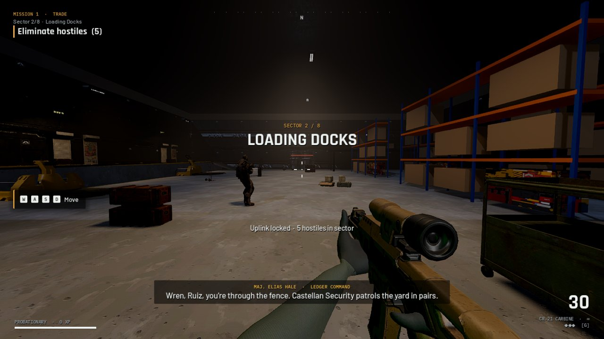
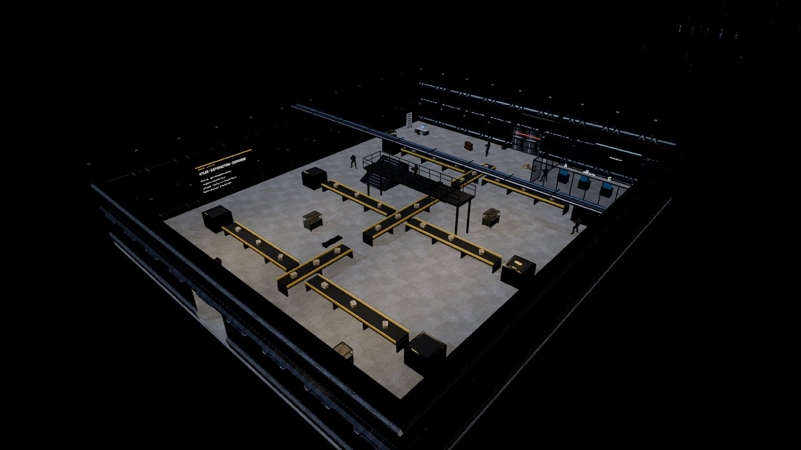
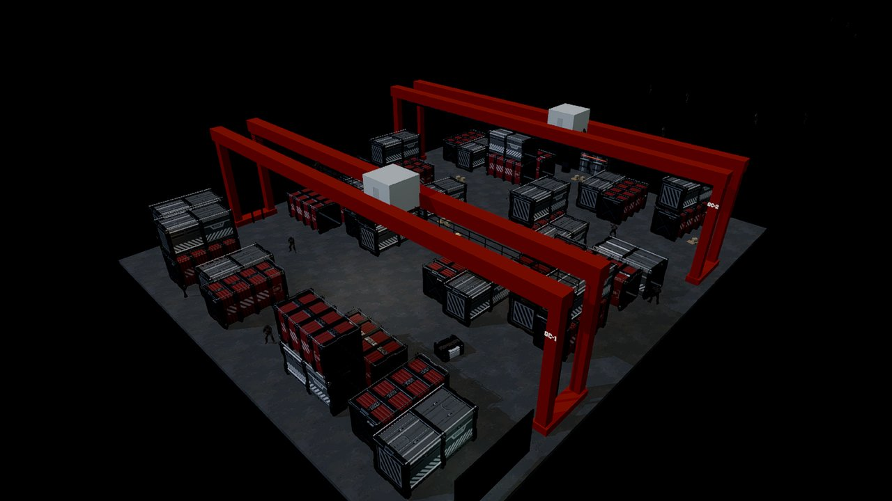
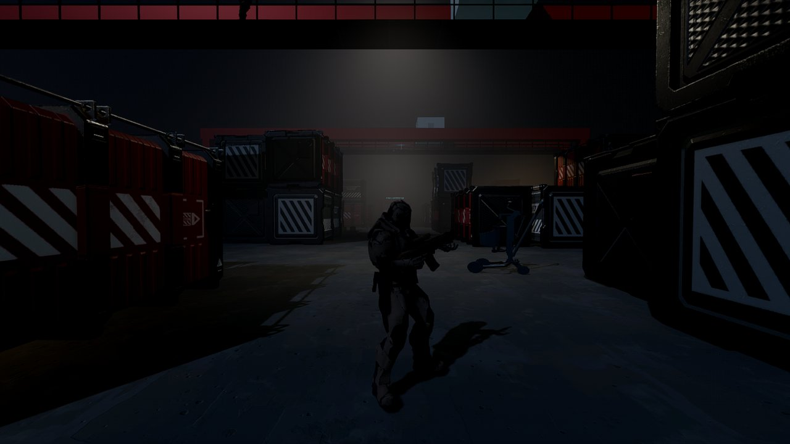
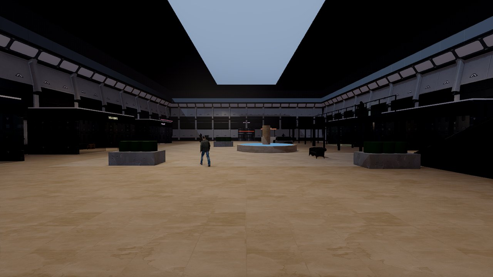
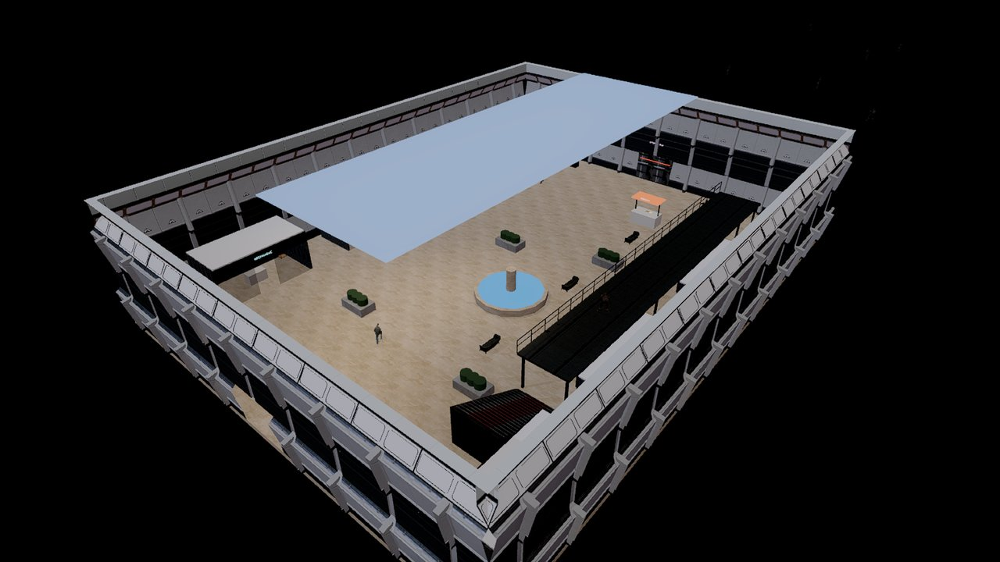
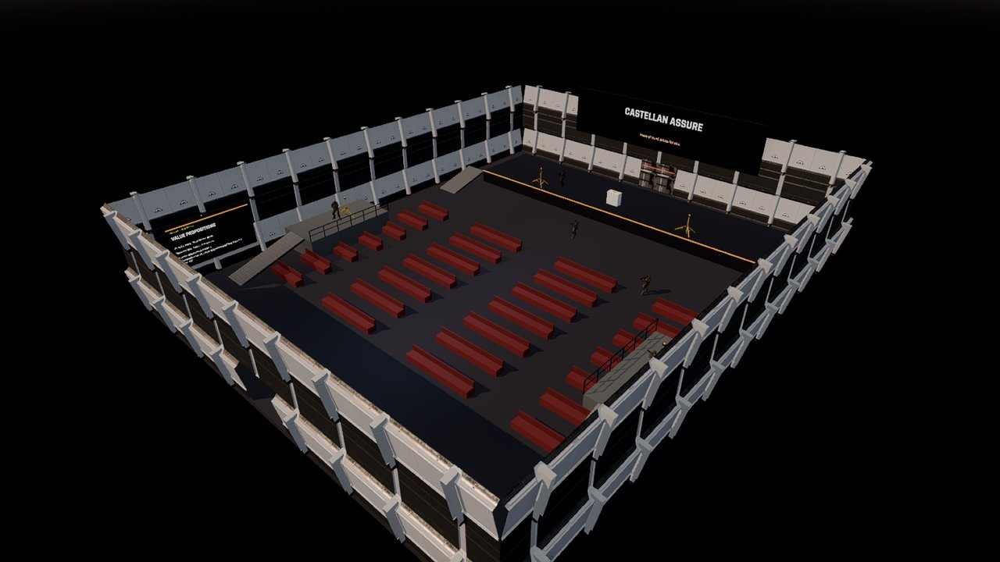
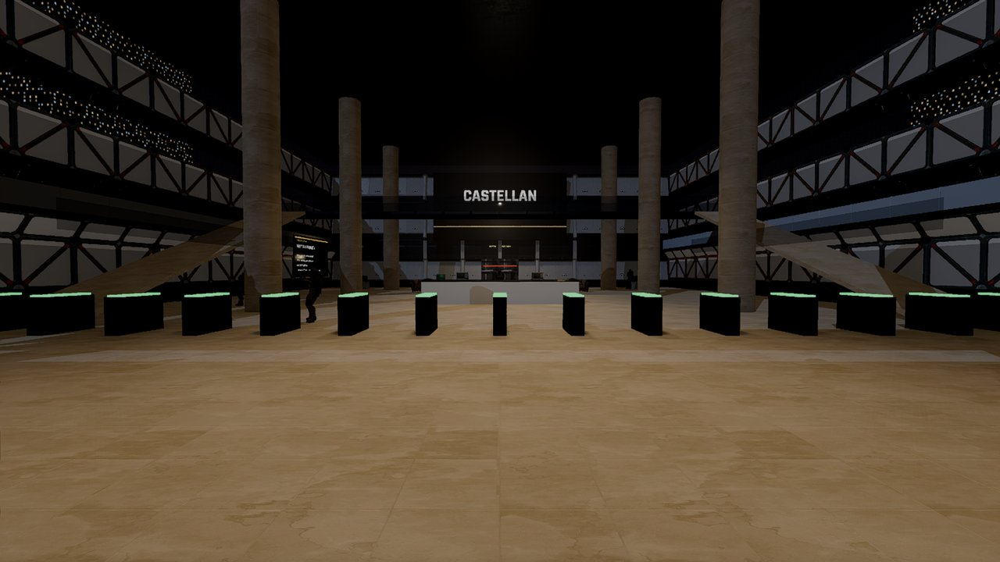
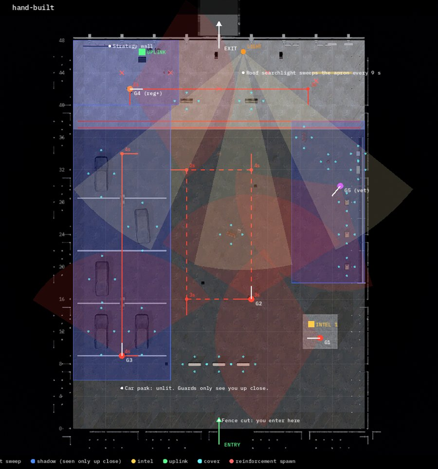
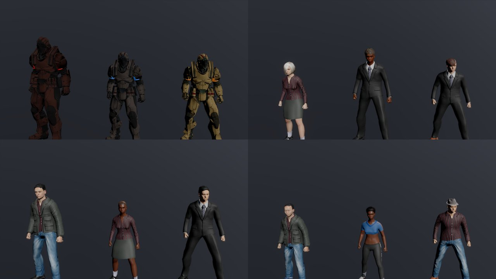

# Operation Value Chain

A story-driven first-person tactical shooter that teaches **Chapters 1–7 of Kotler, Armstrong, Trifts & Buchwitz, _Marketing: An Introduction_ (7th Canadian edition)**.

You play Sgt. Wren of LEDGER, a joint task force taking apart Project Meridian, a scheme by the Castellan Group to buy up the suppliers small towns depend on. Every document you recover is a section of the textbook rewritten as evidence. Every analysis call Dr. Marr asks you to make is a question on that material. Wrong calls set off alarms in the field and come back later as recall checks.

| Mission | Chapter | What you do |
|---|---|---|
| 1 · Trade | 1 · Creating customer value and engagement | Raid a fulfilment centre, identify a director, hold the roof |
| 2 · Portfolio | 2 · Company and marketing strategy | Sabotage the cash cows in a bunker vault, escape |
| 3 · Stormfront | 3 · The marketing environment | Defend crane control in a storm, chase Kessler |
| 4 · Black Site | 4 · Managing marketing information | Infiltrate a data centre undetected, unmask a mole |
| 5 · Black Box | 5 · Consumer and business buyer behaviour | Tail a courier through a mall, walk into an ambush |
| 6 · Segment | 6 · Customer value-driven marketing strategy | Rescue Ruiz, defend the array, provide overwatch |
| 7 · Brand | 7 · Products, services and brands | Hold the brand vault, take down Kessler |
| 8 · The Board | Recall across 1–7 | The final boardroom |

Between missions, a **case board** pieces the story together: string each piece of evidence to the concept that explains it, sort the chapter's framework, and unlock Dr. Marr's case notes, which are the chapter summary, read aloud. Every board can be replayed from **Intel archive → Case boards**.

## Screenshots

All 62 sectors are laid out by hand: every wall, prop, light, guard route and pickup is placed in a level script. Nothing is randomly generated.

<table>
<tr>
<td width="50%"> <b>Sorting Hall</b> · Mission 1. Conveyor lines split the hall into bays, a gantry crosses the middle, and the sort-control room holds the answer consoles.</td>
<td width="50%"> <b>Container Stacks</b> · Mission 3. A container maze under two gantry cranes, with marksmen on the crane walkways.</td>
</tr>
<tr>
<td> The same yard at ground level, in the storm.</td>
<td> <b>Atrium</b> · Mission 5. You tail the courier past the shops and the fountain without being made.</td>
</tr>
<tr>
<td> The atrium from above: six storefronts, a skylight, and a security mezzanine on the east wall.</td>
<td> <b>Value Proposition Hall</b> · Mission 6. A launch auditorium with rows of seats, a stage, and guards on the press risers.</td>
</tr>
<tr>
<td> <b>Tower Lobby</b> · Mission 7. A three-storey glass lobby with security gates and a glass bridge 6 m up.</td>
<td> <b>Level blueprint</b> · Mission 4, Perimeter Yard. Each sector has an overhead plan showing guard routes and sight cones, the searchlight sweep, shadow zones, cover, intel and the uplink. This yard has three ways through: an unlit car park, a floodlit apron, and a generator compound.</td>
</tr>
</table>

*The cast. Top left: Kessler, Hale and Ruiz in their unit colours. The other panels show the Mission 1 directors, Adrian Voss, the courier and civilians.*

## Playing

Download **`OperationValueChain-win64.zip`** from the [latest release](../../releases/latest), unzip it, and run `OperationValueChain\OperationValueChain.exe`. (The same build is also in [`download/`](download/) as seven 7-Zip parts under 30 MB each.) It's a native Godot 4 executable (no installer, no browser runtime). Requires a GPU with Vulkan support (any card from roughly 2016 onward). If it fails to start on an older machine, run it with `--rendering-driver d3d12`.

Controls: WASD, mouse, Shift sprint, Ctrl crouch, Space jump, R reload, G grenade, F takedown, E interact, 1–4 answer, Esc pause. Gamepads work too.

Your progress, settings and every question you've missed are saved in `%APPDATA%\Godot\app_userdata\Operation Value Chain\`. **Intel archive → Weak spots** from the main menu drills everything you've got wrong.

## Building from source

Open the folder in Godot 4.5.1 and export with the included `Windows Desktop` preset.

## Credits

All third-party assets are used under their licences. See the in-game Credits screen, `assets/audio/CREDITS.txt`, and below.

- Engine: Godot Engine 4.5 (MIT)
- Voices: Kokoro-82M by hexgrad (Apache 2.0), via sherpa-onnx (Apache 2.0)
- Music: Tanner Helland (CC BY 4.0); Omri Lahav / 0 A.D., Wildfire Games (CC BY-SA 3.0); Xonotic team (GPLv2+); Christian Fernando Perucchi / Godot TPS demo (CC BY 3.0)
- Sound effects: The Free Firearm Sound Library (CC0); CC-Sounds pack contributors via freesound.org (CC0 / CC BY / CC BY-SA, per-file list in `assets/audio/CREDITS.txt`), Godot TPS demo (CC BY 3.0), Kenney (CC0), gunshots from The Free Firearm Sound Library (CC0)
- Models and textures: Quaternius Modular Sci-Fi MegaKit (CC0); Poly Haven models (CC0); cast built from MakeHuman system assets via MPFB2 (CC0); FPS Arms Rig (CC0); Godot TPS demo by Juan Linietsky and Fernando Miguel Calabró (CC BY 3.0); soldier and rifle from Dive by Mugen87 (MIT); Universal Animation Library 1 & 2, Downtown City MegaKit by Quaternius (CC0); Lee Perry-Smith head scan by Infinite-Realities (CC BY 3.0); first-person arms from the FPS Arms Rig on OpenGameArt (CC0)
- Fonts: Rajdhani, Barlow, IBM Plex Mono (SIL Open Font License)
- Course content follows the textbook named above; definitions are paraphrased or quoted for study purposes.
